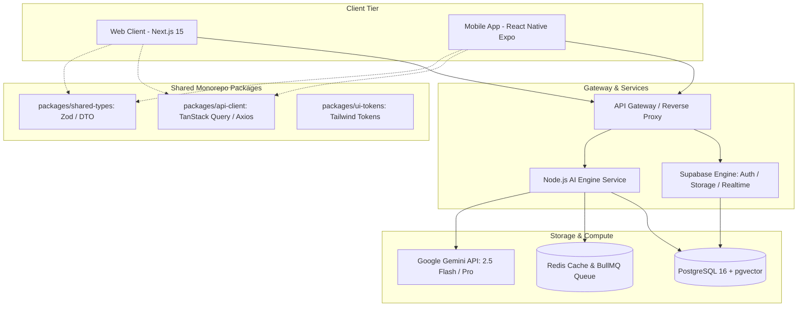
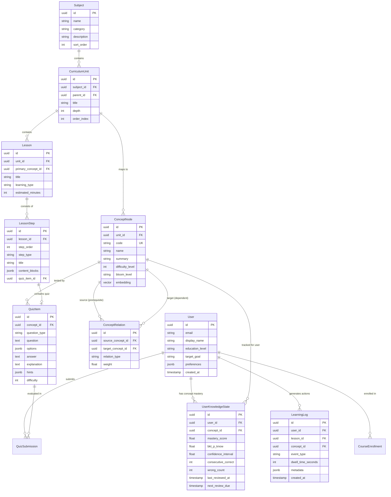
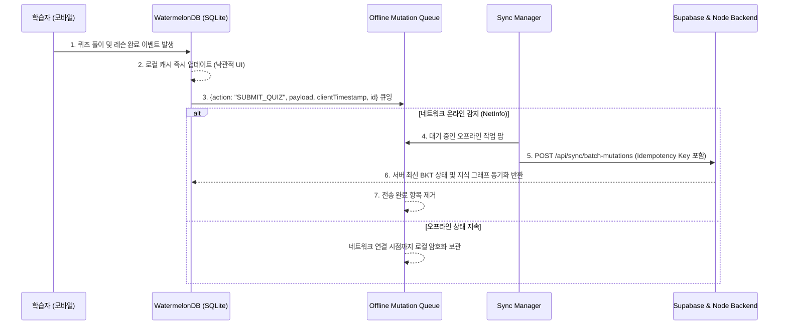

# LearnHub 기술 명세서 (Technical Specification)
**버전**: 1.0.0  
**작성자**: 테크 리드 (프론트엔드/백엔드/클라우드/모바일 아키텍트)  
**대상 프로덕트**: AI 기반 적응형 맞춤 학습 플랫폼 (LearnHub)

---

## 1. 기술 스택 평가 및 최종 선정 (Tech Stack Architecture)

### 1.1 프론트엔드: Next.js 15 (App Router) + Tailwind CSS v4
* **비교 분석**:
  * **Next.js 15 (App Router)** vs **Pure React 19 SPA (Vite)**
  * 교육 플랫폼 특성상 초/중/고/대 교과목 소개, 개념 사전, 공개 커리큘럼 페이지는 **검색 엔진 최적화(SEO) 및 소셜 공유(OG Tag)**가 필수적입니다.
  * 로그인 이후의 학습 대시보드, 노션 스타일 인터랙티브 캔버스, 지식 그래프 뷰어는 클라이언트 컴포넌트(`'use client'`)로 렌더링하여 SPA 수준의 즉각적인 인터랙션을 보장합니다.
* **핵심 라이브러리 조합**:
  * **스타일링**: Tailwind CSS v4 (고성능 네이티브 컴파일러 적용)
  * **노션 스타일 블록 에디터/뷰어**: **Tiptap (ProseMirror 기반)** 또는 **BlockNote**
    * 수식 렌더링: `KaTeX` (`rehype-katex`, `remark-math`)
    * 코드 블록: `Shiki` (경량 고성능 구문 강조)
    * 드래그 앤 드롭 및 블록 인터랙션: `@dnd-kit/core`
  * **인터랙티브 지식 그래프 시각화**: `@xyflow/react` (React Flow)
  * **상태 관리 & 데이터 패칭**:
    * 전역 UI/에디터 상태: `Zustand`
    * 서버 상태 & 캐싱: `TanStack Query v5` (React Query)
    * 애니메이션: `Motion` (Framer Motion v12)

---

### 1.2 백엔드 및 클라우드: Supabase (PostgreSQL 16 + pgvector) + Node.js (TypeScript) AI 오케스트레이션 서버
* **비교 분석**:
  * **Next.js API Routes / Server Actions**: 단순 CRUD에는 편리하나, Gemini AI 스트리밍, 대규모 지식 그래프 백트래킹 계산, 비동기 롱러닝 큐 처리(BullMQ) 시 서버리스 런타임 제약(타임아웃, 메모리) 발생.
  * **Supabase + PostgreSQL 16**: 관계형 모델링, 고성능 BKT 연산, Row Level Security(RLS), pgvector(개념 임베딩 벡터 검색), 기본 Auth/Storage를 즉시 제공하여 개발 공수 60% 절감.
  * **전용 Node.js (TypeScript / Fastify or Express) 서버**: AI 파이프라인(스트리밍 처리, 재시도, 복합 프롬프트 체이닝, Semantic Caching) 및 비동기 작업(BullMQ + Redis)을 안정적으로 전담.
* **ORM & 캐시**:
  * **ORM**: **Drizzle ORM** (TypeScript 네이티브, 제로 오버헤드 SQL 쿼리, `pgvector` 및 복잡한 PostgreSQL 재귀 CTE 쿼리 지원 우수)
  * **캐시 및 큐**: **Redis** (Dragonfly 또는 Upstash) + **BullMQ** (대단원 생성, 취약점 진단 리포트 생성 백그라운드 큐)

---

### 1.3 모바일 앱: React Native (Expo SDK 52+ / New Architecture)
* **비교 분석 (Flutter vs React Native)**:
  | 평가 항목 | React Native (Expo SDK 52+) | Flutter |
  | :--- | :--- | :--- |
  | **코드 재사용성** | **최우수 (85%+)**: TypeScript 타입, Zod 검증, API 클라이언트, 상태 로직(Zustand), 쿼리 훅(TanStack Query) 100% 공유 | 보통 (Dart 언어로 백엔드/프론트엔드 모델과 중복 작성 필요) |
  | **노션 스타일 UI 이식** | **우수**: Web 블록 구조(AST) 및 Markdown/KaTeX 렌더러 로직을 그대로 React Native 컴포넌트로 1:1 매핑 가능 | 별도의 Flutter 렌더링 트리와 위젯 라이브러리 새로 구축 필요 |
  | **개발 생산성** | Web 개발자가 모바일 개발로 즉각 투입 가능 (단일 언어 TypeScript) | Dart 및 Flutter 생태계 학습 곡선 존재 |
  | **성능 (2025/2026 기준)** | New Architecture (Fabric + TurboModules) 기본 활성화로 Flutter와 체감 성능 격차 해소 | Skia/Impeller 엔진 기반으로 고프레임 그래픽 우수 |
* **최종 선정**: **React Native (Expo SDK 52+)**
  * 모노레포(Turborepo) 구축을 통해 Web과 Mobile 간의 Data Layer(API 클라이언트, DTO, 캐싱, 오프라인 큐)를 완벽하게 공유하는 것이 출시 속도 및 유지보수 측면에서 압도적 우위.

---

### 1.4 전체 시스템 아키텍처 다이어그램



---

## 2. 백엔드 데이터 모델 (ERD) 및 스키마 설계

지식 그래프(선수 관계) 추적, 세밀한 학습 로그(체류 시간, 힌트 사용량, 오답 패턴), 베이지안 지식 추적(BKT) 기반 이해도 관리를 위한 완전 정규화 스키마입니다.

### 2.1 ERD 다이어그램 (Mermaid)



---

### 2.2 PostgreSQL DDL 스크립트 (핵심 테이블)

```sql
-- 1. 확장 기능 활성화
CREATE EXTENSION IF NOT EXISTS "uuid-ossp";
CREATE EXTENSION IF NOT EXISTS "pgcrypto";
CREATE EXTENSION IF NOT EXISTS "vector"; -- pgvector for semantic concept embedding

-- 2. 사용자 테이블 (Users)
CREATE TABLE users (
    id UUID PRIMARY KEY DEFAULT gen_random_uuid(),
    email VARCHAR(255) UNIQUE NOT NULL,
    display_name VARCHAR(100) NOT NULL,
    education_level VARCHAR(30) NOT NULL, -- 'elementary' | 'middle' | 'high' | 'university' | 'general'
    target_goal VARCHAR(255),
    daily_study_goal_minutes INT DEFAULT 20,
    created_at TIMESTAMPTZ DEFAULT NOW(),
    updated_at TIMESTAMPTZ DEFAULT NOW()
);

-- 3. 과목 및 단원 (Curriculum / Subject)
CREATE TABLE subjects (
    id UUID PRIMARY KEY DEFAULT gen_random_uuid(),
    name VARCHAR(100) NOT NULL, -- e.g., '수학 (미적분)', '물리학 I', '파이썬 기초'
    category VARCHAR(50) NOT NULL, -- 'math', 'science', 'language', 'cs', 'social'
    grade_level VARCHAR(30) NOT NULL,
    icon_url TEXT,
    sort_order INT DEFAULT 0
);

CREATE TABLE curriculum_units (
    id UUID PRIMARY KEY DEFAULT gen_random_uuid(),
    subject_id UUID NOT NULL REFERENCES subjects(id) ON DELETE CASCADE,
    parent_id UUID REFERENCES curriculum_units(id) ON DELETE CASCADE,
    title VARCHAR(200) NOT NULL,
    depth INT DEFAULT 1, -- 1: 대단원, 2: 중단원, 3: 소단원
    order_index INT NOT NULL,
    created_at TIMESTAMPTZ DEFAULT NOW()
);

-- 4. 개념 노드 및 선수 지식 지식 그래프 (Concept / KnowledgeNode & Relations)
CREATE TABLE concept_nodes (
    id UUID PRIMARY KEY DEFAULT gen_random_uuid(),
    unit_id UUID NOT NULL REFERENCES curriculum_units(id) ON DELETE CASCADE,
    code VARCHAR(100) UNIQUE NOT NULL, -- e.g., 'CALC_LIMIT_001', 'PYTHON_VAR_002'
    name VARCHAR(200) NOT NULL,
    summary TEXT NOT NULL,
    bloom_level VARCHAR(30) DEFAULT 'understand', -- 'remember' | 'understand' | 'apply' | 'analyze' | 'evaluate'
    difficulty_level INT CHECK (difficulty_level BETWEEN 1 AND 10),
    embedding vector(768), -- Gemini Text Embedding (text-embedding-004)
    created_at TIMESTAMPTZ DEFAULT NOW()
);

CREATE TABLE concept_relations (
    id UUID PRIMARY KEY DEFAULT gen_random_uuid(),
    source_concept_id UUID NOT NULL REFERENCES concept_nodes(id) ON DELETE CASCADE, -- 선수 개념
    target_concept_id UUID NOT NULL REFERENCES concept_nodes(id) ON DELETE CASCADE, -- 후수 개념
    relation_type VARCHAR(30) DEFAULT 'PREREQUISITE', -- 'PREREQUISITE' | 'PARALLEL' | 'DEEPEN'
    weight FLOAT DEFAULT 1.0, -- 선수 지식의 중요도 (0.0 ~ 1.0)
    CONSTRAINT uq_concept_pair UNIQUE (source_concept_id, target_concept_id),
    CONSTRAINT chk_no_self_loop CHECK (source_concept_id != target_concept_id)
);

-- 5. 수업 및 노션 스타일 블록 단계 (Lessons & Blocks)
CREATE TABLE lessons (
    id UUID PRIMARY KEY DEFAULT gen_random_uuid(),
    unit_id UUID NOT NULL REFERENCES curriculum_units(id) ON DELETE CASCADE,
    primary_concept_id UUID NOT NULL REFERENCES concept_nodes(id),
    title VARCHAR(255) NOT NULL,
    learning_type VARCHAR(30) NOT NULL, -- 'concept' | 'problem_solving' | 'memorization' | 'language' | 'practical'
    estimated_minutes INT DEFAULT 15,
    order_index INT NOT NULL,
    created_at TIMESTAMPTZ DEFAULT NOW()
);

CREATE TABLE lesson_steps (
    id UUID PRIMARY KEY DEFAULT gen_random_uuid(),
    lesson_id UUID NOT NULL REFERENCES lessons(id) ON DELETE CASCADE,
    step_order INT NOT NULL,
    step_type VARCHAR(30) NOT NULL, -- 'concept' | 'example' | 'practice' | 'quiz' | 'summary'
    title VARCHAR(255) NOT NULL,
    content_blocks JSONB NOT NULL, -- 노션 스타일 AST
    code_snippet JSONB,
    created_at TIMESTAMPTZ DEFAULT NOW()
);

-- 6. 퀴즈 문항 및 풀이 이력
CREATE TABLE quiz_items (
    id UUID PRIMARY KEY DEFAULT gen_random_uuid(),
    concept_id UUID NOT NULL REFERENCES concept_nodes(id) ON DELETE CASCADE,
    question_type VARCHAR(30) NOT NULL, -- 'multiple_choice' | 'short_answer' | 'code_fill'
    question TEXT NOT NULL,
    options JSONB, -- ['선택지1', '선택지2', ...]
    answer TEXT NOT NULL,
    explanation TEXT NOT NULL,
    hints JSONB DEFAULT '[]'::jsonb,
    difficulty INT DEFAULT 3
);

-- 7. 학습 행동 로그 (LearningLog)
CREATE TABLE learning_logs (
    id UUID PRIMARY KEY DEFAULT gen_random_uuid(),
    user_id UUID NOT NULL REFERENCES users(id) ON DELETE CASCADE,
    lesson_id UUID REFERENCES lessons(id) ON DELETE SET NULL,
    concept_id UUID REFERENCES concept_nodes(id) ON DELETE SET NULL,
    event_type VARCHAR(50) NOT NULL, -- 'LESSON_START' | 'STEP_VIEW' | 'QUIZ_ATTEMPT' | 'HINT_CLICK' | 'LESSON_COMPLETE'
    dwell_time_seconds INT DEFAULT 0,
    is_correct BOOLEAN,
    user_response TEXT,
    metadata JSONB DEFAULT '{}'::jsonb,
    recorded_at TIMESTAMPTZ DEFAULT NOW()
);

CREATE INDEX idx_learning_logs_user_concept ON learning_logs(user_id, concept_id, recorded_at DESC);
CREATE INDEX idx_learning_logs_event_time ON learning_logs(event_type, recorded_at DESC);

-- 8. 사용자 개념별 지식 상태 (UserKnowledgeState)
CREATE TABLE user_knowledge_states (
    id UUID PRIMARY KEY DEFAULT gen_random_uuid(),
    user_id UUID NOT NULL REFERENCES users(id) ON DELETE CASCADE,
    concept_id UUID NOT NULL REFERENCES concept_nodes(id) ON DELETE CASCADE,
    mastery_score FLOAT DEFAULT 0.0 CHECK (mastery_score BETWEEN 0.0 AND 1.0),
    bkt_p_know FLOAT DEFAULT 0.1, -- 베이지안 지식 추적 P(L_t)
    confidence_interval FLOAT DEFAULT 0.5,
    consecutive_correct INT DEFAULT 0,
    wrong_count INT DEFAULT 0,
    total_reviews INT DEFAULT 0,
    stability_days FLOAT DEFAULT 1.0, -- Spaced Repetition 망각 반감기
    last_studied_at TIMESTAMPTZ DEFAULT NOW(),
    next_review_due TIMESTAMPTZ DEFAULT NOW(),
    updated_at TIMESTAMPTZ DEFAULT NOW(),
    CONSTRAINT uq_user_concept_state UNIQUE (user_id, concept_id)
);

CREATE INDEX idx_user_knowledge_review ON user_knowledge_states(user_id, next_review_due ASC);
```

---

### 2.3 지식 그래프 재귀 탐색 CTE 쿼리 (선수 지식 결손 탐지)

```sql
WITH RECURSIVE prerequisite_graph AS (
    -- 1. 시작 노드 (목표 개념)의 직전 선수 개념 탐색
    SELECT 
        cr.source_concept_id AS concept_id,
        cr.target_concept_id AS dependent_concept_id,
        1 AS depth,
        ARRAY[cr.target_concept_id, cr.source_concept_id] AS path
    FROM concept_relations cr
    WHERE cr.target_concept_id = :target_concept_id
      AND cr.relation_type = 'PREREQUISITE'
    
    UNION ALL
    
    -- 2. 재귀적으로 상위 선수 개념 추적 (사이클 방지 포함)
    SELECT 
        cr.source_concept_id,
        cr.target_concept_id,
        pg.depth + 1,
        pg.path || cr.source_concept_id
    FROM concept_relations cr
    JOIN prerequisite_graph pg ON cr.target_concept_id = pg.concept_id
    WHERE cr.relation_type = 'PREREQUISITE'
      AND NOT (cr.source_concept_id = ANY(pg.path))
)
SELECT 
    cn.id AS concept_id,
    cn.name AS concept_name,
    cn.difficulty_level,
    pg.depth AS distance_from_target,
    COALESCE(uks.mastery_score, 0.0) AS user_mastery,
    COALESCE(uks.bkt_p_know, 0.0) AS p_know,
    CASE 
        WHEN COALESCE(uks.mastery_score, 0.0) < 0.7 THEN 'DEFICIENT_PREREQUISITE'
        ELSE 'SATISFIED'
    END AS status
FROM prerequisite_graph pg
JOIN concept_nodes cn ON pg.concept_id = cn.id
LEFT JOIN user_knowledge_states uks 
    ON uks.concept_id = cn.id AND uks.user_id = :user_id
ORDER BY pg.depth DESC, user_mastery ASC;
```

---

## 3. Gemini AI 기반 '지식 진단 및 다음 학습 추천' 파이프라인

### 3.1 추천 엔진 원리: Zone of Proximal Development (ZPD; 근접발달영역)
* **진단 알고리즘 의사결정 트리**:
  1. 목표 개념 $C_{target}$ 요청 접수.
  2. 위 재귀 CTE를 실행하여 $C_{target}$의 모든 선수 개념 상태 확인.
  3. **Case 1: 선수 지식 결손 발견 ($Mastery(C_{prereq}) < 0.6$)**  
     -> **역추적 보충 학습(Backtrack Remediation)** 추천: 가장 기초적인 결손 개념으로 우회하여 3분 마이크로 레슨 및 확인 퀴즈 제공.
  4. **Case 2: 선수 지식 충분하나 현재 개념 미숙 ($0.0 \le Mastery(C_{target}) < 0.75$)**  
     -> **단계별 개념 습득(Step-by-step Acquisition)**: Socratic Tutor 대화 및 단계형 블록 학습 추천.
  5. **Case 3: 현재 개념 숙련 완료 ($Mastery(C_{target}) \ge 0.75$)**  
     -> **지식 그래프 상 다음 노드(Next Node Discovery)** 또는 응용 심화 문제 추천.
  6. **Case 4: 망각 주기 도래 ($NOW() \ge next\_review\_due$)**  
     -> **스피드 인터벌 복습(Spaced Repetition)** 세션 우선 삽입.

---

### 3.2 Gemini API 프롬프트 파이프라인 명세

#### 파이프라인 1: 초기 진단 평가 문제 생성 (Adaptive Diagnostic Generator)
* **모델**: `gemini-2.5-flash` (`responseSchema` 적용)

```typescript
export async function generateDiagnosticQuiz(subject: string, targetGrade: string, keyConcepts: Array<{ id: string; name: string; difficulty: number }>) {
  const prompt = `
당신은 국가 공인 교육 평가 전문가이자 교육공학자입니다.
과목: "${subject}"
대상 학습자 수준: "${targetGrade}"
검증해야 할 핵심 개념 목록:
${JSON.stringify(keyConcepts, null, 2)}

[요구사항]
1. 위 개념들의 이해도를 측정할 수 있는 진단 문항 5개를 출제하세요.
2. 하위 기초 개념 2문항, 핵심 개념 2문항, 응용 개념 1문항으로 난이도를 배분하세요.
3. 각 문항은 단순 암기 확인이 아니라 오개념(Misconception)을 판별할 수 있는 매력적인 오답(Distractor)을 포함해야 합니다.
4. 반드시 지정된 JSON 스키마를 엄격히 준수하여 응답하세요.
`;

  const response = await ai.models.generateContent({
    model: "gemini-2.5-flash",
    contents: prompt,
    config: {
      responseMimeType: "application/json",
      responseSchema: {
        type: Type.OBJECT,
        properties: {
          assessmentTitle: { type: Type.STRING },
          targetSubject: { type: Type.STRING },
          questions: {
            type: Type.ARRAY,
            items: {
              type: Type.OBJECT,
              properties: {
                conceptId: { type: Type.STRING },
                conceptName: { type: Type.STRING },
                questionType: { type: Type.STRING, enum: ["multiple_choice", "short_answer"] },
                question: { type: Type.STRING },
                options: { type: Type.ARRAY, items: { type: Type.STRING } },
                correctAnswer: { type: Type.STRING },
                explanation: { type: Type.STRING },
                misconceptionNote: { type: Type.STRING, description: "오답 선택 시 드러나는 인지적 결손 분석" }
              },
              required: ["conceptId", "conceptName", "questionType", "question", "correctAnswer", "explanation", "misconceptionNote"]
            }
          }
        },
        required: ["assessmentTitle", "questions"]
      }
    }
  });

  return JSON.parse(response.text || "{}");
}
```

---

#### 파이프라인 2: 답안 평가 및 인지 진단 파이프라인 (Cognitive Evaluator)

```typescript
export async function evaluateDiagnosticSubmission(
  question: string,
  correctAnswer: string,
  userAnswer: string,
  conceptName: string,
  dwellTimeSeconds: number
) {
  const prompt = `
당신은 인지 진단 평가(Cognitive Diagnostic Assessment) 전문가입니다.
개념: "${conceptName}"
문항: "${question}"
정답: "${correctAnswer}"
학생 답안: "${userAnswer}"
소요 시간: ${dwellTimeSeconds}초

[임무]
1. 정답 여부를 판정하세요 (단답형의 경우 문맥상 동일한 표현 허용).
2. 학생이 오답을 냈다면 원인을 진단하세요:
   - "CONCEPT_MISSING": 개념 자체의 부재 또는 오개념
   - "CALCULATION_SLIP": 원리는 알았으나 연산 실수
   - "MISREADING": 질문 조건 오독
3. 베이지안 지식 추정치 갱신을 위한 신뢰도 가중치(confidenceDelta: -0.3 ~ +0.3)를 산출하세요.
4. 학생에게 즉시 전달할 친절하고 용기를 북돋우는 해설 피드백을 작성하세요.
`;

  const response = await ai.models.generateContent({
    model: "gemini-2.5-flash",
    contents: prompt,
    config: {
      responseMimeType: "application/json",
      responseSchema: {
        type: Type.OBJECT,
        properties: {
          isCorrect: { type: Type.BOOLEAN },
          score: { type: Type.INTEGER },
          errorCategory: { type: Type.STRING, enum: ["NONE", "CONCEPT_MISSING", "CALCULATION_SLIP", "MISREADING"] },
          confidenceDelta: { type: Type.NUMBER },
          pedagogicalFeedback: { type: Type.STRING },
          recommendedAction: { type: Type.STRING, enum: ["ADVANCE", "PRACTICE_SIMILAR", "BACKTRACK_PREREQUISITE"] }
        },
        required: ["isCorrect", "score", "errorCategory", "confidenceDelta", "pedagogicalFeedback", "recommendedAction"]
      }
    }
  });

  return JSON.parse(response.text || "{}");
}
```

---

#### 파이프라인 3: 다음 최적 학습 추천 (Next Best Action Recommender)

```typescript
export async function recommendNextLearningAction(studentProfile: {
  userId: string;
  targetGoal: string;
  deficientConcepts: Array<{ id: string; name: string; mastery: number }>;
  currentUnitConcepts: Array<{ id: string; name: string; mastery: number }>;
  recentStudyHistory: Array<{ conceptName: string; isCorrect: boolean; date: string }>;
}) {
  const prompt = `
당신은 하이퍼 개인화 AI 학습 디렉터입니다.
학생 목표: "${studentProfile.targetGoal}"
결손된 선수 개념 목록: ${JSON.stringify(studentProfile.deficientConcepts)}
현재 진도 개념 목록: ${JSON.stringify(studentProfile.currentUnitConcepts)}
최근 학습 이력: ${JSON.stringify(studentProfile.recentStudyHistory)}

[추천 원칙]
1. 선수 개념 결손(Mastery < 0.6)이 있다면 절대 어려운 진도를 강요하지 말고, '결손 극복 코스'를 1순위로 제안하세요.
2. 선수 개념이 탄탄하다면 현재 단원의 적정 난이도 레슨을 추천하세요.
3. 망각이 우려되는 항목이 있다면 3분 스피드 퀴즈를 제안하세요.
4. 노션 스타일 대시보드에 표시될 매력적인 카드 형태의 브리핑 문구를 구성하세요.
`;

  const response = await ai.models.generateContent({
    model: "gemini-2.5-flash",
    contents: prompt,
    config: {
      responseMimeType: "application/json",
      responseSchema: {
        type: Type.OBJECT,
        properties: {
          recommendationType: { 
            type: Type.STRING, 
            enum: ["REMEDIATION_PREREQUISITE", "CORE_PROGRESS", "SPEED_REVIEW", "CHALLENGE_PROJECT"] 
          },
          primaryTitle: { type: Type.STRING },
          reasoningText: { type: Type.STRING },
          targetConceptId: { type: Type.STRING },
          targetConceptName: { type: Type.STRING },
          estimatedMinutes: { type: Type.INTEGER },
          difficultyBadge: { type: Type.STRING, enum: ["EASY", "OPTIMAL", "CHALLENGE"] },
          actionButtonText: { type: Type.STRING }
        },
        required: ["recommendationType", "primaryTitle", "reasoningText", "targetConceptId", "targetConceptName", "estimatedMinutes", "difficultyBadge", "actionButtonText"]
      }
    }
  });

  return JSON.parse(response.text || "{}");
}
```

---

## 4. 웹 -> 모바일 앱 확장 크로스플랫폼 아키텍처 전략

### 4.1 모노레포 구조 (Turborepo 기반)

```
learnhub/
├── apps/
│   ├── web/                     # Next.js 15 App Router (Web 플랫폼)
│   ├── mobile/                  # React Native Expo SDK 52 (iOS & Android)
│   └── api-server/              # Node.js + Fastify + Gemini AI Worker
│
├── packages/
│   ├── shared-types/            # Zod 스키마, TypeScript DTO (Single Source of Truth)
│   ├── api-client/              # TanStack Query Hook & Axios 인스턴스 (Web & Mobile 100% 공유)
│   └── ui-tokens/               # Tailwind 색상, 폰트, 간격 디자인 토큰
```

---

### 4.2 오프라인 퍼스트(Offline-First) 및 백그라운드 데이터 동기화

통학 버스나 지하철 등 네트워크가 불안정한 환경에서도 모바일 사용자가 끊김 없이 학습하고 퀴즈를 풀 수 있도록 보장합니다.



#### 동기화 핵심 규칙:
1. **클라이언트 측 고유 식별자 생성**:
   * 오프라인 상태에서 생성되는 모든 `LearningLog` 및 `QuizSubmission`은 서버 auto-increment 대신 클라이언트에서 `cuid2` 또는 `uuidv7`으로 ID를 선발급하여 PK 충돌 방지.
2. **멱등성(Idempotency) 보장**:
   * 네트워크 재연결 시 동일 이벤트 중복 전송 방지를 위해 `idempotency_key` (UUID)를 헤더 및 DB unique 제약조건으로 관리.
3. **충돌 해결(Conflict Resolution)**:
   * 단순 학습 로그는 `Append-Only(추가 전용)`.
   * 개념 숙련도(`UserKnowledgeState`)는 서버가 최신 시계열 로그를 기반으로 재계산하는 **Server-Authoritative** 원칙 적용.

---

### 4.3 노션 스타일 공통 블록 AST (Abstract Syntax Tree) 설계

```typescript
// packages/shared-types/src/blocks.ts
export type BlockType = 
  | 'header'
  | 'paragraph'
  | 'callout'
  | 'katex_math'
  | 'code_sandbox'
  | 'interactive_quiz'
  | 'socratic_checkpoint';

export interface NotionBlock {
  id: string;
  type: BlockType;
  properties: {
    level?: 1 | 2 | 3;
    content?: string;
    icon?: string;
    variant?: 'info' | 'warning' | 'tip';
    language?: string;
    code?: string;
    formula?: string; // e.g. "\\int_{a}^{b} f(x)dx = F(b) - F(a)"
    quizId?: string;
  };
  children?: NotionBlock[];
}
```

* **Web 구현**: Tiptap DOM / Tailwind typography 클래스 적용.
* **Mobile 구현**: React Native의 `<Text>`, `<View>`, `react-native-math-view` (KaTeX 네이티브 렌더링), `@react-native-clipboard` 적용.

---

## 5. 실무 마일스톤 및 즉각 착수 태스크 (Roadmap)

1. **Sprint 1 (주차 1~2): 코어 데이터 모델 및 API 스캐폴딩**
   - Supabase 프로젝트 생성 및 위 DDL 스크립트 배포.
   - Turborepo 세팅 및 `@learnhub/shared-types`, `@learnhub/api-client` 패키지 구성.
2. **Sprint 2 (주차 3~4): Gemini 지식 진단 파이프라인 및 백트래킹 쿼리**
   - 재귀 CTE 쿼리 연동 및 `generateDiagnosticQuiz`, `evaluateDiagnosticSubmission` 엔드포인트 구현.
   - 노션 스타일 블록 렌더러 코어 컴포넌트 개발.
3. **Sprint 3 (주차 5~6): Web MVP 런칭**
   - 초/중/고/대 샘플 과목(수학, 물리, 프로그래밍) 지식 그래프 데이터 인제스천.
   - 적응형 진단 -> 다음 학습 추천 -> 레슨 플레이어 -> 복습 사이클 완료.
4. **Sprint 4 (주차 7~8): 모바일 앱 (Expo) 포팅 및 오프라인 싱크 연동**
   - Turborepo에 `apps/mobile` Expo 프로젝트 추가 후 공유 클라이언트로 화면 구축.
   - 오프라인 큐 및 WatermelonDB 로컬 캐시 연동.
